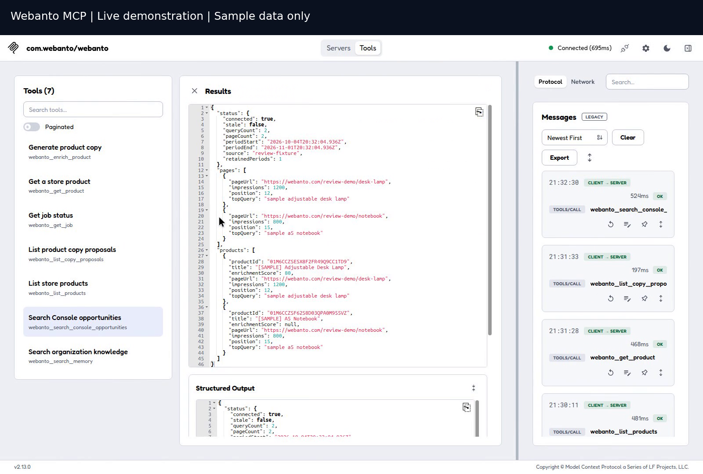

# Webanto MCP connector

Connect your AI assistant to a Webanto workspace to review product content, inspect SEO opportunities, and use organization knowledge.

## Install in Cline

Connect to the hosted Streamable HTTP endpoint at `https://webanto.com/api/mcp`.
No local server process or backend source download is required.

In Cline, add a remote MCP server and choose **Streamable HTTP**, or merge this
entry into the IDE MCP settings without replacing your existing servers:

```json
{
  "mcpServers": {
    "webanto": {
      "type": "streamableHttp",
      "url": "https://webanto.com/api/mcp",
      "autoApprove": [],
      "disabled": false
    }
  }
}
```

For Cline CLI:

```sh
cline mcp add webanto https://webanto.com/api/mcp --transport http --yes
```

A Webanto account and OAuth consent are required. Use Cline’s OAuth connection flow. Select the intended business and review the requested scopes before allowing access. A privately configured API key is also supported by Webanto; never put a real credential in a public example. Keep tool auto-approval disabled. Tool discovery does not grant
permission to run a protected action; scopes and native approvals still apply.
See [Cline setup guidance](llms-install.md). Support: support@webanto.com.

## Install in Gemini CLI

```sh
gemini extensions install https://github.com/empline/webanto-mcp
```

Use `/mcp auth webanto` if sign-in is requested. The extension uses the hosted Streamable HTTP endpoint at `https://webanto.com/api/mcp`; OAuth discovery and dynamic client registration handle sign-in. No API key or client secret is bundled.

## Capabilities and access

### What you can do

- Browse products synced to Webanto from Shopify and WooCommerce.
- Read a product and compare current content with copy proposals.
- Request a copy proposal and track the enrichment job.
- Inspect imported Google Search Console opportunities and data freshness.
- Retrieve brand guidance and uploaded organization knowledge.

Copy proposals require review. Available tools depend on granted scopes and organization permissions. Supported publication requires preparation and an exact native Webanto review before execution; creating a proposal alone does not publish it. Read-only installation tests do not certify publication or other mutation workflows.

### Walkthrough

[Watch the live MCP walkthrough](https://raw.githubusercontent.com/empline/webanto-mcp/main/assets/walkthrough.mp4). The recording uses the official MCP Inspector against the real endpoint and an isolated workspace with labelled sample data. It records an earlier seven-tool review profile and its unsupported-action limits. Discover the current catalog from the endpoint; available tools depend on the server version and granted scopes. Pauses are shortened; credentials are excluded.



### Requirements

You need a Webanto account and permission to connect the selected organization. The relevant store products, Search Console import, or organization knowledge must already exist in Webanto. Product enrichment requires an active subscription and available AI credits. Knowledge search consumes an embedding credit. OAuth scopes and your current organization permissions limit access on every call.

### Other clients

Use `https://webanto.com/api/mcp` in Claude or ChatGPT. The included `plugin.json` and `mcp.json` provide the OpenAI plugin package metadata; directory availability is subject to review.

## Tool exposure

Policy: `runtime-discovery`. The client discovers the server-authorized catalog at runtime. Tool discovery does not grant scopes or approve actions.

Authentication policy: `discovery`. The hosted endpoint is `https://webanto.com/api/mcp`. No credentials or automatic tool approvals are bundled.

## Update or uninstall

```sh
gemini extensions update webanto
gemini extensions uninstall webanto
```

Pin `--ref <full-commit-sha>` when a reproducible installation is required.

## Verification

Run `npm ci` and `npm test`. The canonical JSON AST guard rejects metadata drift and duplicate keys; mutation tests prove refusal of unsafe configuration and bypassed validation. The installed pre-commit and pre-push hooks run the same checks on the workstation. GitHub Actions are disabled. These packaging checks do not certify signed-in workflows or live service behavior.

## Links

[Setup documentation](https://webanto.com/ai/mcp) · [Support](https://webanto.com/contact) · [Privacy](https://webanto.com/privacy) · [Terms](https://webanto.com/terms)

Support: support@webanto.com · [Privacy](https://webanto.com/privacy) · [Terms](https://webanto.com/terms)
